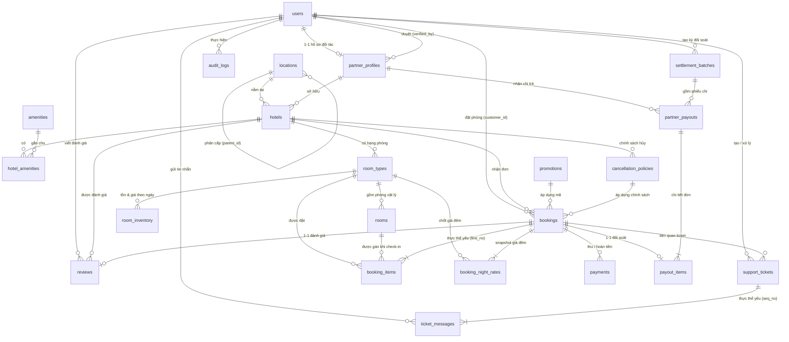

# Thiết kế Cơ sở dữ liệu PostgreSQL — Hệ thống Quản lý Đặt phòng Khách sạn Trực tuyến (OTA)

- **Ngày thiết kế:** 2026-11-20
- **Tài liệu gốc:** [De_cuong_va_ke_hoach_do_an_CSDL_Dat_Phong_Khach_San.md](../../De_cuong_va_ke_hoach_do_an_CSDL_Dat_Phong_Khach_San.md)
- **Phạm vi thực hiện (Hướng 1):** Tài liệu thiết kế CSDL hoàn chỉnh (ERD, chuẩn hóa ≥ 3NF, thuyết minh phi chuẩn hóa, Từ điển dữ liệu 100% cột của 22 bảng) + bộ script PostgreSQL chạy thật trong `database/` (DDL, Roles, Functions, Stored Procedures, Triggers, Views, Indexes, 20 truy vấn Q01–Q20, Seed mẫu kiểm chứng, Backup/Restore) và kiểm thử thực thi sạch trên PostgreSQL 18 (Docker).

---

## 1. Kiến trúc và Quyết định Thiết kế PostgreSQL

### 1.1 Quy ước chung
- **Khóa chính (PK):** Bảng độc lập dùng `BIGINT GENERATED ALWAYS AS IDENTITY`; bảng liên kết N–N (`hotel_amenities`) và thực thể yếu (`booking_items`, `ticket_messages`) hoặc bảng theo khóa tự nhiên nghiệp vụ (`room_inventory`, `payout_items`) dùng khóa chính ghép.
- **Tiền tệ & Tỷ lệ:** Toàn bộ giá trị tiền VND dùng `NUMERIC(18, 0)`; tỷ lệ phần trăm dùng `NUMERIC(5, 2)`; điểm đánh giá trung bình dùng `NUMERIC(3, 2)`. Tuyệt đối không dùng `REAL`/`DOUBLE PRECISION`.
- **Thời gian:** Dùng `TIMESTAMPTZ` (múi giờ UTC/Asia/Ho_Chi_Minh nhất quán) cho dấu thời gian sự kiện và `DATE` cho ngày lưu trú/kỳ đối soát.
- **Tách lớp DDL và SQL nâng cao (tránh Prisma drift):** Theo rủi ro X.2 trong đề cương, các đối tượng đặc thù PostgreSQL (`GENERATED ALWAYS AS IDENTITY`, composite FK `MATCH SIMPLE`, partial/covering index `INCLUDE ... WHERE`, `PROCEDURE`, `FUNCTION`, `TRIGGER`, `VIEW`, `ROLE`) được quản lý tường minh trong `database/` theo thứ tự đánh số `01_` → `09_`.

### 1.2 Quyết định khóa chặt ràng buộc nghiệp vụ ở tầng CSDL
1. **BR06 (Đơn chỉ chứa loại phòng thuộc cùng 1 khách sạn):** Tạo `UNIQUE(id, hotel_id)` trên `hotels`? Không cần trên `hotels`, chỉ cần `UNIQUE(id, hotel_id)` trên `room_types`, `cancellation_policies` và `bookings`; sau đó `bookings` dùng composite FK `(policy_id, hotel_id) -> cancellation_policies(id, hotel_id)`, và `booking_items` lưu `hotel_id` với 2 composite FK: `(booking_id, hotel_id) -> bookings(id, hotel_id)` và `(room_type_id, hotel_id) -> room_types(id, hotel_id)`.
2. **BR10 (Gán phòng vật lý đúng loại phòng và đang `AVAILABLE`):** Tạo `UNIQUE(id, room_type_id)` trên `rooms` và composite FK `(assigned_room_id, room_type_id) -> rooms(id, room_type_id)` trên `booking_items` (PostgreSQL `MATCH SIMPLE` tự bỏ qua kiểm tra khi `assigned_room_id IS NULL`, và ép khớp `room_type_id` ngay khi gán phòng). Trạng thái `AVAILABLE` và chống gán trùng phòng đang `CHECKED_IN` được kiểm tra bởi trigger và thủ tục check-in.
3. **Phân tách dòng `booking_items` để gán phòng vật lý 1–1 (`quantity = 1` mỗi dòng khi giữ phòng qua SP):** Giữ nguyên 22 bảng theo đúng đặc tả; khi `sp_create_booking_hold` nhận `quantity = N`, thủ tục chèn `N` dòng `booking_items` (`line_no = 1..N`, mỗi dòng `quantity = 1`) để khi check-in mỗi phòng vật lý có 1 `assigned_room_id` riêng biệt (vẫn giữ `CHECK (quantity > 0)` trên bảng).
4. **BR15 (Ticket gắn `booking_id` phải thuộc khách hàng hoặc đối tác của đơn):** Trigger `BEFORE INSERT OR UPDATE` trên `support_tickets` đối chiếu `customer_id` (người mở ticket) với `bookings.customer_id` hoặc `hotels.partner_id` của đơn đó.
5. **BR18 (Bất biến dữ liệu tài chính & kiểm toán):** Trigger chặn `DELETE` và chặn `UPDATE` trực tiếp trên `audit_logs`, `payout_items`, chứng từ `payments` có `status = 'SUCCESS'`, và `partner_payouts` đã `PAID`.
6. **Truy vết người thực hiện trong Trigger Audit:** Ứng dụng hoặc thủ tục đặt `SET LOCAL app.current_actor_id = '<user_id>'` trong transaction; trigger `trg_audit_log_changes` đọc qua `NULLIF(current_setting('app.current_actor_id', TRUE), '')::BIGINT`.

---

## 2. Sơ đồ Thực thể – Liên kết (ERD) — 22 Thực thể

Đầy đủ 5 nhóm quan hệ bắt buộc:
- **1–1:** `users` – `partner_profiles`; `bookings` – `reviews`.
- **1–N:** `hotels` – `room_types`, `hotels` – `cancellation_policies`, `room_types` – `rooms`, `room_types` – `room_inventory`, `bookings` – `payments`, `bookings` – `booking_night_rates`, `settlement_batches` – `partner_payouts`, `partner_payouts` – `payout_items` (1–1 trên `booking_id` nhưng 1–N từ `partner_payouts`), v.v.
- **N–N:** `hotels` – `amenities` qua `hotel_amenities`.
- **Phân cấp (tự tham chiếu):** `locations.parent_id` → `locations.id`.
- **Thực thể yếu:** `booking_items` (`PK(booking_id, line_no)`) và `ticket_messages` (`PK(ticket_id, seq_no)`).



---

## 3. Chuẩn hóa Lược đồ (≥ 3NF) và Phi chuẩn hóa có kiểm soát

### 3.1 Chứng minh 3NF cho 04 bảng tiêu biểu

#### Bảng 1: `room_inventory(room_type_id, stay_date, total_allotment, booked_count, held_count, nightly_price, is_closed, updated_at)`
- **Khóa ứng viên:** $K = \{(\text{room\_type\_id}, \text{stay\_date})\}$.
- **Phụ thuộc hàm (FD):**
  - $(\text{room\_type\_id}, \text{stay\_date}) \to \text{total\_allotment}, \text{booked\_count}, \text{held\_count}, \text{nightly\_price}, \text{is\_closed}, \text{updated\_at}$.
- **Kiểm tra chuẩn:**
  - **1NF:** Mọi thuộc tính nguyên tố, không lặp nhóm.
  - **2NF:** Không có thuộc tính không khóa nào phụ thuộc vào bộ phận của khóa chính (vì giá và tồn phòng biến động theo **cả** loại phòng lẫn ngày cụ thể; thuộc tính tĩnh như `room_types.name`, `base_price` đã tách sang `room_types`).
  - **3NF:** Không có phụ thuộc bắc cầu giữa các thuộc tính không khóa (`nightly_price`, `is_closed`, `total_allotment` độc lập nhau và phụ thuộc trực tiếp vào khóa ghép). Đạt **BCNF**.

#### Bảng 2: `bookings(id, booking_code, customer_id, hotel_id, promotion_id, policy_id, check_in_date, check_out_date, guest_count, status, commission_rate_snapshot, room_subtotal, discount_amount, total_amount, commission_amount, hold_expires_at, cancelled_at, cancel_reason, created_at, updated_at)`
- **Khóa ứng viên:** $K_1 = \{\text{id}\}$, $K_2 = \{\text{booking\_code}\}$.
- **Phụ thuộc hàm:**
  - $\text{id} \leftrightarrow \text{booking\_code}$
  - $\text{id} \to \text{customer\_id}, \text{hotel\_id}, \text{promotion\_id}, \text{policy\_id}, \text{check\_in\_date}, \text{check\_out\_date}, \text{guest\_count}, \text{status}, \text{commission\_rate\_snapshot}, \dots$
  - Các thuộc tính của khách hàng (`full_name`, `email`), khách sạn (`hotel_name`, `address`), chính sách (`free_cancel_hours`, `penalty_percent`) và khuyến mãi (`discount_type`) đều đã tách sang `users`, `hotels`, `cancellation_policies`, `promotions` — tránh bắc cầu $\text{id} \to \text{customer\_id} \to \text{email}$.
- **Lưu ý tổng dẫn xuất:** `total_amount` và `commission_amount` là snapshot tài chính bất biến tại thời điểm chốt đơn (xem mục 3.2); không phụ thuộc vào giá bảng `room_inventory` hay `hotels.commission_rate` hiện hành sau thời điểm đặt. Đạt **3NF**.

#### Bảng 3: `booking_items(booking_id, line_no, hotel_id, room_type_id, assigned_room_id, quantity, nights, unit_price_avg, line_total)`
- **Khóa ứng viên:** $K = \{(\text{booking\_id}, \text{line\_no})\}$.
- **Phụ thuộc hàm:**
  - $(\text{booking\_id}, \text{line\_no}) \to \text{room\_type\_id}, \text{assigned\_room\_id}, \text{quantity}, \text{nights}, \text{unit\_price\_avg}, \text{line\_total}$.
  - Thuộc tính mô tả của hạng phòng (`name`, `max_adults`) nằm ở `room_types`; thông tin phòng vật lý (`room_number`, `floor`) nằm ở `rooms`.
  - Riêng `hotel_id` lặp có chủ đích từ `bookings.hotel_id` và `room_types.hotel_id` chỉ nhằm tạo composite FK ở tầng vật lý ép BR06 (không lưu dữ liệu mô tả khách sạn). Đạt **3NF** về ngữ nghĩa dữ liệu, khóa toàn vẹn đa bảng.

#### Bảng 4: `partner_payouts(id, batch_id, partner_id, gross_amount, commission_total, net_payout, status, paid_at, payment_reference, created_at)`
- **Khóa ứng viên:** $K_1 = \{\text{id}\}$, $K_2 = \{(\text{batch\_id}, \text{partner\_id})\}$.
- **Phụ thuộc hàm:**
  - $\text{id} \leftrightarrow (\text{batch\_id}, \text{partner\_id}) \to \text{gross\_amount}, \text{commission\_total}, \text{net\_payout}, \text{status}, \text{paid\_at}, \text{payment\_reference}, \text{created\_at}$.
  - Thông tin ngân hàng (`bank_account`, `bank_name`) và mã số thuế (`tax_code`) nằm ở `partner_profiles`, không đưa vào `partner_payouts` nên loại bỏ phụ thuộc bắc cầu $\text{id} \to \text{partner\_id} \to \text{bank\_account}$. Đạt **3NF / BCNF**.

### 3.2 Thuyết minh Phi chuẩn hóa có kiểm soát
| Bảng & Cột phi chuẩn hóa | Lý do chấp nhận | Cơ chế giữ nhất quán |
| :--- | :--- | :--- |
| `hotels.avg_rating`, `hotels.review_count` | Trang tìm kiếm & danh sách khách sạn truy vấn thường xuyên; tránh `AVG/COUNT` trên hàng trăm nghìn đánh giá mỗi lần search. | Trigger `trg_validate_and_sync_review` tự động tính lại chỉ từ `reviews` có `moderation_status = 'VISIBLE'` sau mọi `INSERT/UPDATE/DELETE`. |
| `booking_night_rates.nightly_price_snapshot` & `bookings.commission_rate_snapshot` | Quy tắc BR07 yêu cầu bất biến giá và tỷ lệ hoa hồng tại thời điểm đặt dù đối tác/admin sửa giá hoặc sửa `commission_rate` về sau. | Ghi 1 lần trong `sp_create_booking_hold` khi tạo đơn; không sửa sau khi tạo. |
| `bookings.room_subtotal`, `discount_amount`, `total_amount`, `commission_amount`; `booking_items.unit_price_avg`, `line_total` | Snapshot công nợ tài chính phục vụ thanh toán, đối soát và phát hiện lệch (Q18) mà không phụ thuộc biến động danh mục. | Tính tập trung trong `sp_create_booking_hold`, kiểm tra bằng `CHECK (total_amount = GREATEST(room_subtotal - discount_amount, 0))` và đối chiếu qua Q18. |
| `booking_items.hotel_id` | Bắt buộc có trong `booking_items` để khai báo composite FK `(booking_id, hotel_id)` và `(room_type_id, hotel_id)`. | Khóa cứng bằng FK tới `bookings(id, hotel_id)` và `room_types(id, hotel_id)`. |

---

## 4. Từ điển Dữ liệu Đầy đủ (100% cột — 22 Bảng)

### Nhóm A: Người dùng, Đối tác và Danh mục nền

#### 1. `users` — Tài khoản chung 05 vai trò
| Cột | Kiểu dữ liệu | Null | Mặc định | Ràng buộc | Mô tả & Ví dụ |
| :--- | :--- | :--- | :--- | :--- | :--- |
| `id` | `BIGINT` | `NOT NULL` | `IDENTITY` | `PK` | Khóa chính tự tăng (`1`) |
| `email` | `VARCHAR(255)` | `NOT NULL` | — | `UNIQUE` | Email đăng nhập duy nhất (`an.nguyen@example.vn`) |
| `password_hash` | `VARCHAR(255)` | `NOT NULL` | — | — | Mật khẩu đã băm bcrypt/Argon2 |
| `full_name` | `VARCHAR(150)` | `NOT NULL` | — | — | Họ tên đầy đủ (`Nguyễn Văn An`) |
| `phone` | `VARCHAR(20)` | `NULL` | `NULL` | — | Số điện thoại liên hệ (`0901234567`) |
| `role` | `VARCHAR(20)` | `NOT NULL` | — | `CHECK IN ('ADMIN','PARTNER','CUSTOMER','SUPPORT','ACCOUNTANT')` | Vai trò A01–A05 (`CUSTOMER`) |
| `is_active` | `BOOLEAN` | `NOT NULL` | `TRUE` | — | Trạng thái hoạt động tài khoản (`TRUE`) |
| `created_at` | `TIMESTAMPTZ` | `NOT NULL` | `NOW()` | — | Thời điểm tạo tài khoản |
| `updated_at` | `TIMESTAMPTZ` | `NOT NULL` | `NOW()` | — | Thời điểm cập nhật gần nhất |

#### 2. `partner_profiles` — Hồ sơ kinh doanh/ngân hàng của Đối tác (1–1 với `users`)
| Cột | Kiểu dữ liệu | Null | Mặc định | Ràng buộc | Mô tả & Ví dụ |
| :--- | :--- | :--- | :--- | :--- | :--- |
| `user_id` | `BIGINT` | `NOT NULL` | — | `PK`, `FK -> users(id)` (`ON DELETE RESTRICT ON UPDATE CASCADE`) | Mã tài khoản đối tác (`2`) |
| `business_name` | `VARCHAR(200)` | `NOT NULL` | — | — | Tên pháp nhân/khách sạn (`Công ty TNHH Lưu trú Ánh Dương`) |
| `tax_code` | `VARCHAR(50)` | `NOT NULL` | — | `UNIQUE` | Mã số thuế duy nhất (`0108123456`) |
| `bank_account` | `VARCHAR(50)` | `NOT NULL` | — | — | Số tài khoản nhận chi trả (`19031234567890`) |
| `bank_name` | `VARCHAR(120)` | `NOT NULL` | — | — | Tên ngân hàng (`Techcombank`) |
| `bank_branch` | `VARCHAR(120)` | `NULL` | `NULL` | — | Chi nhánh ngân hàng (`Chi nhánh Hoàn Kiếm`) |
| `kyc_status` | `VARCHAR(20)` | `NOT NULL` | `'PENDING'` | `CHECK IN ('PENDING','APPROVED','REJECTED','SUSPENDED')` | Trạng thái duyệt KYC (`APPROVED`) |
| `rejection_reason` | `TEXT` | `NULL` | `NULL` | — | Lý do từ chối/tạm khóa nếu có |
| `verified_by` | `BIGINT` | `NULL` | `NULL` | `FK -> users(id)` (`ON DELETE SET NULL ON UPDATE CASCADE`) | Admin A01 phê duyệt hồ sơ |
| `verified_at` | `TIMESTAMPTZ` | `NULL` | `NULL` | — | Thời điểm phê duyệt KYC |
| `created_at` | `TIMESTAMPTZ` | `NOT NULL` | `NOW()` | — | Ngày gửi hồ sơ |
| `updated_at` | `TIMESTAMPTZ` | `NOT NULL` | `NOW()` | — | Ngày cập nhật hồ sơ |

#### 3. `locations` — Cây phân cấp địa điểm (tự tham chiếu)
| Cột | Kiểu dữ liệu | Null | Mặc định | Ràng buộc | Mô tả & Ví dụ |
| :--- | :--- | :--- | :--- | :--- | :--- |
| `id` | `BIGINT` | `NOT NULL` | `IDENTITY` | `PK` | Mã địa điểm (`10`) |
| `parent_id` | `BIGINT` | `NULL` | `NULL` | `FK -> locations(id)` (`ON DELETE RESTRICT ON UPDATE CASCADE`), `CHECK (parent_id IS DISTINCT FROM id)` | Mã địa điểm cha (`1` = Việt Nam) |
| `code` | `VARCHAR(50)` | `NOT NULL` | — | `UNIQUE` | Mã định danh địa điểm (`VN-HN-HK`) |
| `name` | `VARCHAR(150)` | `NOT NULL` | — | — | Tên địa danh (`Quận Hoàn Kiếm`) |
| `level` | `VARCHAR(20)` | `NOT NULL` | — | `CHECK IN ('COUNTRY','PROVINCE','DISTRICT','AREA')` | Cấp hành chính/khu vực (`DISTRICT`) |
| `created_at` | `TIMESTAMPTZ` | `NOT NULL` | `NOW()` | — | Thời điểm tạo |

#### 4. `amenities` — Danh mục tiện ích dùng chung
| Cột | Kiểu dữ liệu | Null | Mặc định | Ràng buộc | Mô tả & Ví dụ |
| :--- | :--- | :--- | :--- | :--- | :--- |
| `id` | `BIGINT` | `NOT NULL` | `IDENTITY` | `PK` | Mã tiện ích (`1`) |
| `code` | `VARCHAR(50)` | `NOT NULL` | — | `UNIQUE` | Mã chuẩn (`FREE_WIFI`) |
| `name` | `VARCHAR(120)` | `NOT NULL` | — | — | Tên hiển thị (`Wi-Fi miễn phí`) |
| `category` | `VARCHAR(50)` | `NOT NULL` | — | `CHECK IN ('GENERAL','ROOM','DINING','WELLNESS','BUSINESS','ACCESSIBILITY')` | Nhóm tiện ích (`GENERAL`) |
| `created_at` | `TIMESTAMPTZ` | `NOT NULL` | `NOW()` | — | Thời điểm tạo |

#### 5. `promotions` — Mã khuyến mãi toàn sàn
| Cột | Kiểu dữ liệu | Null | Mặc định | Ràng buộc | Mô tả & Ví dụ |
| :--- | :--- | :--- | :--- | :--- | :--- |
| `id` | `BIGINT` | `NOT NULL` | `IDENTITY` | `PK` | Mã khuyến mãi (`1`) |
| `code` | `VARCHAR(50)` | `NOT NULL` | — | `UNIQUE` | Mã code khách nhập (`HE2026`) |
| `name` | `VARCHAR(150)` | `NOT NULL` | — | — | Tên chương trình (`Ưu đãi mùa hè 2026`) |
| `discount_type` | `VARCHAR(20)` | `NOT NULL` | — | `CHECK IN ('FIXED','PERCENT')` | Kiểu giảm cố định hoặc % (`FIXED`) |
| `discount_value` | `NUMERIC(18,2)` | `NOT NULL` | — | `CHECK (discount_value > 0)`, `CHECK (discount_type <> 'PERCENT' OR discount_value <= 100)` | Giá trị giảm (`200000` hoặc `10.00`) |
| `max_discount_amount` | `NUMERIC(18,0)` | `NULL` | `NULL` | `CHECK (max_discount_amount IS NULL OR max_discount_amount >= 0)` | Trần giảm tối đa cho loại `PERCENT` (`500000`) |
| `min_order_amount` | `NUMERIC(18,0)` | `NOT NULL` | `0` | `CHECK (min_order_amount >= 0)` | Giá trị đơn tối thiểu (`1000000`) |
| `valid_from` | `TIMESTAMPTZ` | `NOT NULL` | — | — | Bắt đầu hiệu lực |
| `valid_to` | `TIMESTAMPTZ` | `NOT NULL` | — | `CHECK (valid_to > valid_from)` | Hết hạn hiệu lực |
| `usage_limit` | `INT` | `NOT NULL` | — | `CHECK (usage_limit > 0)` | Giới hạn tổng lượt dùng (`1000`) |
| `used_count` | `INT` | `NOT NULL` | `0` | `CHECK (used_count >= 0 AND used_count <= usage_limit)` | Số lượt đã sử dụng (`124`) |
| `is_active` | `BOOLEAN` | `NOT NULL` | `TRUE` | — | Trạng thái bật/tắt mã (`TRUE`) |
| `created_at` | `TIMESTAMPTZ` | `NOT NULL` | `NOW()` | — | Thời điểm tạo |

---

### Nhóm B: Khách sạn, Phòng và Quỹ phòng theo ngày

#### 6. `hotels` — Thông tin khách sạn
| Cột | Kiểu dữ liệu | Null | Mặc định | Ràng buộc | Mô tả & Ví dụ |
| :--- | :--- | :--- | :--- | :--- | :--- |
| `id` | `BIGINT` | `NOT NULL` | `IDENTITY` | `PK` | Mã khách sạn (`101`) |
| `partner_id` | `BIGINT` | `NOT NULL` | — | `FK -> partner_profiles(user_id)` (`ON DELETE RESTRICT ON UPDATE CASCADE`) | Chủ sở hữu đối tác (`2`) |
| `location_id` | `BIGINT` | `NOT NULL` | — | `FK -> locations(id)` (`ON DELETE RESTRICT ON UPDATE CASCADE`) | Địa điểm trực thuộc (`10`) |
| `code` | `VARCHAR(50)` | `NOT NULL` | — | `UNIQUE` | Mã khách sạn duy nhất (`HTL-HN-001`) |
| `name` | `VARCHAR(200)` | `NOT NULL` | — | — | Tên khách sạn (`Khách sạn Hoàng Gia Hà Nội`) |
| `address` | `VARCHAR(300)` | `NOT NULL` | — | — | Địa chỉ chi tiết (`12 Hàng Trống, Hoàn Kiếm`) |
| `description` | `TEXT` | `NULL` | `NULL` | — | Mô tả tổng quan khách sạn |
| `star_rating` | `SMALLINT` | `NOT NULL` | — | `CHECK (star_rating BETWEEN 1 AND 5)` | Hạng sao (`4`) |
| `approval_status` | `VARCHAR(20)` | `NOT NULL` | `'PENDING'` | `CHECK IN ('PENDING','APPROVED','REJECTED','SUSPENDED')` | Trạng thái kiểm duyệt (`APPROVED`) |
| `commission_rate` | `NUMERIC(5,2)` | `NOT NULL` | `15.00` | `CHECK (commission_rate BETWEEN 0 AND 100)` | Tỷ lệ hoa hồng sàn % (`15.00`) |
| `avg_rating` | `NUMERIC(3,2)` | `NOT NULL` | `0.00` | `CHECK (avg_rating BETWEEN 0 AND 5)` | Điểm đánh giá TB đồng bộ qua trigger (`4.65`) |
| `review_count` | `INT` | `NOT NULL` | `0` | `CHECK (review_count >= 0)` | Số đánh giá hiển thị (`84`) |
| `is_active` | `BOOLEAN` | `NOT NULL` | `TRUE` | — | Trạng thái mở hoạt động (`TRUE`) |
| `created_at` | `TIMESTAMPTZ` | `NOT NULL` | `NOW()` | — | Thời điểm tạo |
| `updated_at` | `TIMESTAMPTZ` | `NOT NULL` | `NOW()` | — | Thời điểm cập nhật |

#### 7. `hotel_amenities` — Bảng trung gian N–N khách sạn và tiện ích
| Cột | Kiểu dữ liệu | Null | Mặc định | Ràng buộc | Mô tả & Ví dụ |
| :--- | :--- | :--- | :--- | :--- | :--- |
| `hotel_id` | `BIGINT` | `NOT NULL` | — | `PK`, `FK -> hotels(id)` (`ON DELETE CASCADE ON UPDATE CASCADE`) | Mã khách sạn (`101`) |
| `amenity_id` | `BIGINT` | `NOT NULL` | — | `PK`, `FK -> amenities(id)` (`ON DELETE RESTRICT ON UPDATE CASCADE`) | Mã tiện ích (`1`) |

#### 8. `cancellation_policies` — Chính sách hủy phòng của khách sạn
| Cột | Kiểu dữ liệu | Null | Mặc định | Ràng buộc | Mô tả & Ví dụ |
| :--- | :--- | :--- | :--- | :--- | :--- |
| `id` | `BIGINT` | `NOT NULL` | `IDENTITY` | `PK`, `UNIQUE(id, hotel_id)` | Mã chính sách (`1`) |
| `hotel_id` | `BIGINT` | `NOT NULL` | — | `FK -> hotels(id)` (`ON DELETE RESTRICT ON UPDATE CASCADE`) | Khách sạn sở hữu (`101`) |
| `name` | `VARCHAR(150)` | `NOT NULL` | — | — | Tên chính sách (`Miễn phí hủy trước 48h`) |
| `free_cancel_hours` | `INT` | `NOT NULL` | — | `CHECK (free_cancel_hours >= 0)` | Số giờ trước check-in miễn phí hủy (`48`) |
| `penalty_percent` | `NUMERIC(5,2)` | `NOT NULL` | — | `CHECK (penalty_percent BETWEEN 0 AND 100)` | Phạt % khi hủy trễ (`50.00`) |
| `is_default` | `BOOLEAN` | `NOT NULL` | `FALSE` | Partial `UNIQUE(hotel_id) WHERE is_default = TRUE` | Chính sách mặc định của khách sạn |
| `created_at` | `TIMESTAMPTZ` | `NOT NULL` | `NOW()` | — | Thời điểm tạo |

#### 9. `room_types` — Hạng phòng thuộc khách sạn
| Cột | Kiểu dữ liệu | Null | Mặc định | Ràng buộc | Mô tả & Ví dụ |
| :--- | :--- | :--- | :--- | :--- | :--- |
| `id` | `BIGINT` | `NOT NULL` | `IDENTITY` | `PK`, `UNIQUE(id, hotel_id)` | Mã loại phòng (`501`) |
| `hotel_id` | `BIGINT` | `NOT NULL` | — | `FK -> hotels(id)` (`ON DELETE RESTRICT ON UPDATE CASCADE`), `UNIQUE(hotel_id, code)` | Khách sạn chủ quản (`101`) |
| `code` | `VARCHAR(50)` | `NOT NULL` | — | `UNIQUE(hotel_id, code)` | Mã loại phòng trong khách sạn (`DLX`) |
| `name` | `VARCHAR(150)` | `NOT NULL` | — | — | Tên hạng phòng (`Deluxe Hướng Phố`) |
| `description` | `TEXT` | `NULL` | `NULL` | — | Mô tả diện tích, giường, view |
| `max_adults` | `SMALLINT` | `NOT NULL` | — | `CHECK (max_adults > 0)` | Số người lớn tối đa (`2`) |
| `max_children` | `SMALLINT` | `NOT NULL` | `0` | `CHECK (max_children >= 0)` | Số trẻ em tối đa (`1`) |
| `base_price` | `NUMERIC(18,0)` | `NOT NULL` | — | `CHECK (base_price >= 0)` | Giá tham chiếu cơ sở VND (`1000000`) |
| `total_rooms` | `INT` | `NOT NULL` | — | `CHECK (total_rooms > 0)` | Tổng số phòng thực tế của hạng (`10`) |
| `is_active` | `BOOLEAN` | `NOT NULL` | `TRUE` | — | Trạng thái kinh doanh (`TRUE`) |
| `created_at` | `TIMESTAMPTZ` | `NOT NULL` | `NOW()` | — | Thời điểm tạo |
| `updated_at` | `TIMESTAMPTZ` | `NOT NULL` | `NOW()` | — | Thời điểm cập nhật |

#### 10. `rooms` — Phòng vật lý cụ thể
| Cột | Kiểu dữ liệu | Null | Mặc định | Ràng buộc | Mô tả & Ví dụ |
| :--- | :--- | :--- | :--- | :--- | :--- |
| `id` | `BIGINT` | `NOT NULL` | `IDENTITY` | `PK`, `UNIQUE(id, room_type_id)` | Mã phòng vật lý (`2001`) |
| `room_type_id` | `BIGINT` | `NOT NULL` | — | `FK -> room_types(id)` (`ON DELETE RESTRICT ON UPDATE CASCADE`), `UNIQUE(room_type_id, room_number)` | Thuộc hạng phòng (`501`) |
| `room_number` | `VARCHAR(30)` | `NOT NULL` | — | `UNIQUE(room_type_id, room_number)` | Số hiệu phòng (`302`) |
| `floor` | `SMALLINT` | `NULL` | `NULL` | — | Tầng (`3`) |
| `status` | `VARCHAR(20)` | `NOT NULL` | `'AVAILABLE'` | `CHECK IN ('AVAILABLE','OCCUPIED','MAINTENANCE','OUT_OF_SERVICE')` | Trạng thái vật lý (`AVAILABLE`) |
| `created_at` | `TIMESTAMPTZ` | `NOT NULL` | `NOW()` | — | Thời điểm tạo |
| `updated_at` | `TIMESTAMPTZ` | `NOT NULL` | `NOW()` | — | Thời điểm cập nhật |

#### 11. `room_inventory` — Quỹ phòng và giá theo từng ngày (bảng quy mô ≥ 100.000 dòng)
| Cột | Kiểu dữ liệu | Null | Mặc định | Ràng buộc | Mô tả & Ví dụ |
| :--- | :--- | :--- | :--- | :--- | :--- |
| `room_type_id` | `BIGINT` | `NOT NULL` | — | `PK`, `FK -> room_types(id)` (`ON DELETE RESTRICT ON UPDATE CASCADE`) | Mã hạng phòng (`501`) |
| `stay_date` | `DATE` | `NOT NULL` | — | `PK` | Ngày lưu trú (`2026-12-20`) |
| `total_allotment` | `INT` | `NOT NULL` | — | `CHECK (total_allotment >= 0)` | Tổng quỹ phòng mở bán (`10`) |
| `booked_count` | `INT` | `NOT NULL` | `0` | `CHECK (booked_count >= 0)` | Số phòng đã thanh toán/đặt (`4`) |
| `held_count` | `INT` | `NOT NULL` | `0` | `CHECK (held_count >= 0)`, `CHECK (booked_count + held_count <= total_allotment)` | Số phòng đang giữ chỗ tạm (`1`) |
| `nightly_price` | `NUMERIC(18,0)` | `NOT NULL` | — | `CHECK (nightly_price >= 0)` | Giá bán đêm này VND (`1200000`) |
| `is_closed` | `BOOLEAN` | `NOT NULL` | `FALSE` | — | Cờ đóng bán ngày này (`FALSE`) |
| `updated_at` | `TIMESTAMPTZ` | `NOT NULL` | `NOW()` | — | Lần cập nhật tồn/giá gần nhất |

---

### Nhóm C: Đặt phòng, Thanh toán, Đánh giá, Hỗ trợ, Đối soát và Kiểm toán

#### 12. `bookings` — Đơn đặt phòng chính (≥ 10.000 / ≥ 100.000 dòng)
| Cột | Kiểu dữ liệu | Null | Mặc định | Ràng buộc | Mô tả & Ví dụ |
| :--- | :--- | :--- | :--- | :--- | :--- |
| `id` | `BIGINT` | `NOT NULL` | `IDENTITY` | `PK`, `UNIQUE(id, hotel_id)` | Mã đơn đặt phòng (`90001`) |
| `booking_code` | `VARCHAR(32)` | `NOT NULL` | — | `UNIQUE` | Mã đặt phòng hiển thị (`BK-20261120-0001`) |
| `customer_id` | `BIGINT` | `NOT NULL` | — | `FK -> users(id)` (`ON DELETE RESTRICT ON UPDATE CASCADE`) | Khách hàng đặt (`15`) |
| `hotel_id` | `BIGINT` | `NOT NULL` | — | `FK -> hotels(id)` (`ON DELETE RESTRICT ON UPDATE CASCADE`) | Khách sạn được đặt (`101`) |
| `promotion_id` | `BIGINT` | `NULL` | `NULL` | `FK -> promotions(id)` (`ON DELETE RESTRICT ON UPDATE CASCADE`) | Mã khuyến mãi áp dụng (`1`) |
| `policy_id` | `BIGINT` | `NOT NULL` | — | `FK (policy_id, hotel_id) -> cancellation_policies(id, hotel_id)` (`ON DELETE RESTRICT`) | Chính sách hủy chốt trên đơn (`1`) |
| `check_in_date` | `DATE` | `NOT NULL` | — | — | Ngày nhận phòng (`2026-12-20`) |
| `check_out_date` | `DATE` | `NOT NULL` | — | `CHECK (check_out_date > check_in_date)` | Ngày trả phòng (`2026-12-22`) |
| `guest_count` | `SMALLINT` | `NOT NULL` | — | `CHECK (guest_count > 0)` | Tổng số khách (`2`) |
| `status` | `VARCHAR(20)` | `NOT NULL` | `'HOLD'` | `CHECK IN ('HOLD','PENDING_PAYMENT','CONFIRMED','CHECKED_IN','COMPLETED','CANCELLED')` | Trạng thái vòng đời đơn (`CONFIRMED`) |
| `commission_rate_snapshot` | `NUMERIC(5,2)` | `NOT NULL` | — | `CHECK (commission_rate_snapshot BETWEEN 0 AND 100)` | Tỷ lệ hoa hồng % chốt lúc đặt (`15.00`) |
| `room_subtotal` | `NUMERIC(18,0)` | `NOT NULL` | — | `CHECK (room_subtotal >= 0)` | Tổng tiền phòng trước giảm giá (`4400000`) |
| `discount_amount` | `NUMERIC(18,0)` | `NOT NULL` | `0` | `CHECK (discount_amount >= 0)` | Tiền giảm giá sàn tài trợ (`200000`) |
| `total_amount` | `NUMERIC(18,0)` | `NOT NULL` | — | `CHECK (total_amount >= 0)`, `CHECK (total_amount = GREATEST(room_subtotal - discount_amount, 0))` | Số tiền khách phải trả (`4200000`) |
| `commission_amount` | `NUMERIC(18,0)` | `NOT NULL` | `0` | `CHECK (commission_amount >= 0)` | Tiền hoa hồng sàn dự kiến (`660000`) |
| `hold_expires_at` | `TIMESTAMPTZ` | `NULL` | `NULL` | — | Mốc hết hạn giữ chỗ (`NOW() + 15 minutes`) |
| `cancelled_at` | `TIMESTAMPTZ` | `NULL` | `NULL` | — | Thời điểm hủy đơn nếu có |
| `cancel_reason` | `TEXT` | `NULL` | `NULL` | — | Lý do hủy đơn |
| `created_at` | `TIMESTAMPTZ` | `NOT NULL` | `NOW()` | — | Thời điểm tạo đơn |
| `updated_at` | `TIMESTAMPTZ` | `NOT NULL` | `NOW()` | — | Thời điểm cập nhật |

#### 13. `booking_items` — Chi tiết hạng mục đặt phòng (Thực thể yếu)
| Cột | Kiểu dữ liệu | Null | Mặc định | Ràng buộc | Mô tả & Ví dụ |
| :--- | :--- | :--- | :--- | :--- | :--- |
| `booking_id` | `BIGINT` | `NOT NULL` | — | `PK`, `FK -> bookings(id)` (`ON DELETE CASCADE ON UPDATE CASCADE`) | Mã đơn đặt phòng (`90001`) |
| `line_no` | `INT` | `NOT NULL` | — | `PK`, `CHECK (line_no > 0)` | Số thứ tự dòng trong đơn (`1`) |
| `hotel_id` | `BIGINT` | `NOT NULL` | — | `FK (booking_id, hotel_id) -> bookings(id, hotel_id)` (`ON DELETE CASCADE`) | Khớp khách sạn của đơn (`101`) |
| `room_type_id` | `BIGINT` | `NOT NULL` | — | `FK (room_type_id, hotel_id) -> room_types(id, hotel_id)` (`ON DELETE RESTRICT`) | Loại phòng đặt, cùng khách sạn (`501`) |
| `assigned_room_id` | `BIGINT` | `NULL` | `NULL` | `FK (assigned_room_id, room_type_id) -> rooms(id, room_type_id)` (`ON DELETE RESTRICT`) | Phòng vật lý gán khi check-in (`2001`) |
| `quantity` | `INT` | `NOT NULL` | — | `CHECK (quantity > 0)` | Số phòng đặt (`2`) |
| `nights` | `INT` | `NOT NULL` | — | `CHECK (nights > 0)` | Số đêm lưu trú (`2`) |
| `unit_price_avg` | `NUMERIC(18,0)` | `NOT NULL` | — | `CHECK (unit_price_avg >= 0)` | Đơn giá trung bình/đêm (`1100000`) |
| `line_total` | `NUMERIC(18,0)` | `NOT NULL` | — | `CHECK (line_total >= 0)` | Thành tiền dòng (`4400000`) |

#### 14. `booking_night_rates` — Snapshot giá từng đêm bất biến (≥ 200.000 dòng)
| Cột | Kiểu dữ liệu | Null | Mặc định | Ràng buộc | Mô tả & Ví dụ |
| :--- | :--- | :--- | :--- | :--- | :--- |
| `id` | `BIGINT` | `NOT NULL` | `IDENTITY` | `PK` | Khóa chính tự tăng |
| `booking_id` | `BIGINT` | `NOT NULL` | — | `FK -> bookings(id)` (`ON DELETE CASCADE ON UPDATE CASCADE`), `UNIQUE(booking_id, room_type_id, stay_date)` | Mã đơn đặt phòng (`90001`) |
| `room_type_id` | `BIGINT` | `NOT NULL` | — | `FK -> room_types(id)` (`ON DELETE RESTRICT ON UPDATE CASCADE`) | Mã loại phòng (`501`) |
| `stay_date` | `DATE` | `NOT NULL` | — | `UNIQUE(booking_id, room_type_id, stay_date)` | Ngày lưu trú từng đêm (`2026-12-20`) |
| `quantity` | `INT` | `NOT NULL` | — | `CHECK (quantity > 0)` | Số phòng giữ/đặt đêm đó (`2`) |
| `nightly_price_snapshot` | `NUMERIC(18,0)` | `NOT NULL` | — | `CHECK (nightly_price_snapshot >= 0)` | Giá chốt tại thời điểm đặt (`1000000`) |

#### 15. `payments` — Giao dịch thu tiền và hoàn tiền
| Cột | Kiểu dữ liệu | Null | Mặc định | Ràng buộc | Mô tả & Ví dụ |
| :--- | :--- | :--- | :--- | :--- | :--- |
| `id` | `BIGINT` | `NOT NULL` | `IDENTITY` | `PK` | Mã giao dịch (`1`) |
| `booking_id` | `BIGINT` | `NOT NULL` | — | `FK -> bookings(id)` (`ON DELETE RESTRICT ON UPDATE CASCADE`) | Đơn đặt phòng liên quan (`90001`) |
| `payment_type` | `VARCHAR(20)` | `NOT NULL` | — | `CHECK IN ('CHARGE','REFUND')` | Loại giao dịch thu hoặc hoàn (`CHARGE`) |
| `method` | `VARCHAR(30)` | `NOT NULL` | — | `CHECK IN ('MOCK_CARD','MOCK_BANK_TRANSFER','MOCK_WALLET','INTERNAL_ADJUSTMENT')` | Phương thức mô phỏng (`MOCK_CARD`) |
| `amount` | `NUMERIC(18,0)` | `NOT NULL` | — | `CHECK (amount > 0)` | Số tiền giao dịch VND (`4200000`) |
| `status` | `VARCHAR(20)` | `NOT NULL` | `'PENDING'` | `CHECK IN ('PENDING','SUCCESS','FAILED')` | Trạng thái giao dịch (`SUCCESS`) |
| `idempotency_key` | `VARCHAR(100)` | `NOT NULL` | — | `UNIQUE` | Khóa chống lặp giao dịch (`pay-90001-retry1`) |
| `paid_at` | `TIMESTAMPTZ` | `NULL` | `NULL` | — | Thời điểm thanh toán thành công |
| `created_at` | `TIMESTAMPTZ` | `NOT NULL` | `NOW()` | — | Thời điểm khởi tạo giao dịch |

#### 16. `reviews` — Đánh giá sau lưu trú (1–1 với `bookings`)
| Cột | Kiểu dữ liệu | Null | Mặc định | Ràng buộc | Mô tả & Ví dụ |
| :--- | :--- | :--- | :--- | :--- | :--- |
| `id` | `BIGINT` | `NOT NULL` | `IDENTITY` | `PK` | Mã đánh giá |
| `booking_id` | `BIGINT` | `NOT NULL` | — | `UNIQUE`, `FK -> bookings(id)` (`ON DELETE RESTRICT ON UPDATE CASCADE`) | Mỗi đơn tối đa 01 đánh giá (`90001`) |
| `customer_id` | `BIGINT` | `NOT NULL` | — | `FK -> users(id)` (`ON DELETE RESTRICT ON UPDATE CASCADE`) | Phải khớp `bookings.customer_id` (trigger) |
| `hotel_id` | `BIGINT` | `NOT NULL` | — | `FK -> hotels(id)` (`ON DELETE RESTRICT ON UPDATE CASCADE`) | Phải khớp `bookings.hotel_id` (trigger) |
| `rating` | `SMALLINT` | `NOT NULL` | — | `CHECK (rating BETWEEN 1 AND 5)` | Điểm sao 1–5 (`5`) |
| `comment` | `TEXT` | `NULL` | `NULL` | — | Nội dung nhận xét (`Phòng sạch sẽ, nhân viên nhiệt tình`) |
| `moderation_status` | `VARCHAR(20)` | `NOT NULL` | `'VISIBLE'` | `CHECK IN ('VISIBLE','HIDDEN')` | Trạng thái kiểm duyệt (`VISIBLE`) |
| `moderation_reason` | `TEXT` | `NULL` | `NULL` | — | Lý do ẩn nếu vi phạm |
| `moderated_by` | `BIGINT` | `NULL` | `NULL` | `FK -> users(id)` (`ON DELETE SET NULL ON UPDATE CASCADE`) | Nhân viên A04 ẩn đánh giá |
| `created_at` | `TIMESTAMPTZ` | `NOT NULL` | `NOW()` | — | Thời điểm gửi đánh giá |
| `updated_at` | `TIMESTAMPTZ` | `NOT NULL` | `NOW()` | — | Thời điểm cập nhật |

#### 17. `support_tickets` — Phiếu hỗ trợ / khiếu nại
| Cột | Kiểu dữ liệu | Null | Mặc định | Ràng buộc | Mô tả & Ví dụ |
| :--- | :--- | :--- | :--- | :--- | :--- |
| `id` | `BIGINT` | `NOT NULL` | `IDENTITY` | `PK` | Mã ticket (`1`) |
| `ticket_code` | `VARCHAR(32)` | `NOT NULL` | — | `UNIQUE` | Mã ticket hiển thị (`TK-20261120-001`) |
| `booking_id` | `BIGINT` | `NULL` | `NULL` | `FK -> bookings(id)` (`ON DELETE RESTRICT ON UPDATE CASCADE`) | Đơn liên quan nếu có (`90001`) |
| `customer_id` | `BIGINT` | `NOT NULL` | — | `FK -> users(id)` (`ON DELETE RESTRICT ON UPDATE CASCADE`) | Người gửi (khách hàng hoặc đối tác của đơn — BR15) |
| `assigned_staff_id` | `BIGINT` | `NULL` | `NULL` | `FK -> users(id)` (`ON DELETE SET NULL ON UPDATE CASCADE`) | Nhân viên hỗ trợ A04 phụ trách |
| `category` | `VARCHAR(30)` | `NOT NULL` | — | `CHECK IN ('BOOKING','PAYMENT','REFUND','SERVICE_QUALITY','PARTNER_DISPUTE','OTHER')` | Phân loại sự cố (`REFUND`) |
| `priority` | `VARCHAR(20)` | `NOT NULL` | `'MEDIUM'` | `CHECK IN ('LOW','MEDIUM','HIGH','URGENT')` | Mức độ ưu tiên (`HIGH`) |
| `status` | `VARCHAR(20)` | `NOT NULL` | `'OPEN'` | `CHECK IN ('OPEN','IN_PROGRESS','WAITING_CUSTOMER','RESOLVED','CLOSED')` | Trạng thái xử lý (`OPEN`) |
| `subject` | `VARCHAR(255)` | `NOT NULL` | — | — | Tiêu đề phiếu (`Yêu cầu hỗ trợ hoàn tiền do bão`) |
| `created_at` | `TIMESTAMPTZ` | `NOT NULL` | `NOW()` | — | Thời điểm mở ticket |
| `resolved_at` | `TIMESTAMPTZ` | `NULL` | `NULL` | — | Thời điểm giải quyết/đóng ticket |
| `updated_at` | `TIMESTAMPTZ` | `NOT NULL` | `NOW()` | — | Thời điểm cập nhật |

#### 18. `ticket_messages` — Tin nhắn & ghi chú nội bộ trên ticket (Thực thể yếu)
| Cột | Kiểu dữ liệu | Null | Mặc định | Ràng buộc | Mô tả & Ví dụ |
| :--- | :--- | :--- | :--- | :--- | :--- |
| `ticket_id` | `BIGINT` | `NOT NULL` | — | `PK`, `FK -> support_tickets(id)` (`ON DELETE CASCADE ON UPDATE CASCADE`) | Mã ticket (`1`) |
| `seq_no` | `INT` | `NOT NULL` | — | `PK`, `CHECK (seq_no > 0)` | Số thứ tự tin nhắn (`1`) |
| `sender_id` | `BIGINT` | `NOT NULL` | — | `FK -> users(id)` (`ON DELETE RESTRICT ON UPDATE CASCADE`) | Người gửi tin nhắn |
| `message_body` | `TEXT` | `NOT NULL` | — | — | Nội dung trao đổi |
| `is_internal_note` | `BOOLEAN` | `NOT NULL` | `FALSE` | — | `TRUE` = ghi chú nội bộ ẩn khỏi khách/đối tác |
| `created_at` | `TIMESTAMPTZ` | `NOT NULL` | `NOW()` | — | Thời điểm gửi |

#### 19. `settlement_batches` — Đợt đối soát định kỳ
| Cột | Kiểu dữ liệu | Null | Mặc định | Ràng buộc | Mô tả & Ví dụ |
| :--- | :--- | :--- | :--- | :--- | :--- |
| `id` | `BIGINT` | `NOT NULL` | `IDENTITY` | `PK` | Mã đợt đối soát (`1`) |
| `batch_code` | `VARCHAR(32)` | `NOT NULL` | — | `UNIQUE` | Mã kỳ đối soát (`STL-202611-01`) |
| `period_start` | `DATE` | `NOT NULL` | — | — | Ngày bắt đầu kỳ (`2026-11-01`) |
| `period_end` | `DATE` | `NOT NULL` | — | `CHECK (period_end >= period_start)` | Ngày kết thúc kỳ (`2026-11-15`) |
| `created_by` | `BIGINT` | `NOT NULL` | — | `FK -> users(id)` (`ON DELETE RESTRICT ON UPDATE CASCADE`) | Kế toán A05 tạo đợt |
| `status` | `VARCHAR(20)` | `NOT NULL` | `'DRAFT'` | `CHECK IN ('DRAFT','FINALIZED','PAID')` | Trạng thái kỳ (`FINALIZED`) |
| `created_at` | `TIMESTAMPTZ` | `NOT NULL` | `NOW()` | — | Thời điểm chốt kỳ |

#### 20. `partner_payouts` — Phiếu chi trả cho từng đối tác trong kỳ
| Cột | Kiểu dữ liệu | Null | Mặc định | Ràng buộc | Mô tả & Ví dụ |
| :--- | :--- | :--- | :--- | :--- | :--- |
| `id` | `BIGINT` | `NOT NULL` | `IDENTITY` | `PK` | Mã phiếu payout (`1`) |
| `batch_id` | `BIGINT` | `NOT NULL` | — | `FK -> settlement_batches(id)` (`ON DELETE RESTRICT ON UPDATE CASCADE`), `UNIQUE(batch_id, partner_id)` | Thuộc kỳ đối soát (`1`) |
| `partner_id` | `BIGINT` | `NOT NULL` | — | `FK -> partner_profiles(user_id)` (`ON DELETE RESTRICT ON UPDATE CASCADE`), `UNIQUE(batch_id, partner_id)` | Đối tác thụ hưởng (`2`) |
| `gross_amount` | `NUMERIC(18,0)` | `NOT NULL` | — | `CHECK (gross_amount >= 0)` | Tổng tiền phòng hợp lệ (`4400000`) |
| `commission_total` | `NUMERIC(18,0)` | `NOT NULL` | — | `CHECK (commission_total >= 0)` | Tổng hoa hồng sàn giữ lại (`660000`) |
| `net_payout` | `NUMERIC(18,0)` | `NOT NULL` | — | `CHECK (net_payout >= 0)`, `CHECK (net_payout = gross_amount - commission_total)` | Số tiền thực chi đối tác (`3740000`) |
| `status` | `VARCHAR(20)` | `NOT NULL` | `'PENDING'` | `CHECK IN ('PENDING','PAID','CANCELLED')` | Trạng thái chi trả (`PAID`) |
| `paid_at` | `TIMESTAMPTZ` | `NULL` | `NULL` | — | Thời điểm chuyển khoản |
| `payment_reference` | `VARCHAR(100)` | `NULL` | `NULL` | — | Mã ủy nhiệm chi ngân hàng (`UNC-20261116-99`) |
| `created_at` | `TIMESTAMPTZ` | `NOT NULL` | `NOW()` | — | Thời điểm sinh phiếu |

#### 21. `payout_items` — Chi tiết đơn đặt phòng trong phiếu chi trả
| Cột | Kiểu dữ liệu | Null | Mặc định | Ràng buộc | Mô tả & Ví dụ |
| :--- | :--- | :--- | :--- | :--- | :--- |
| `payout_id` | `BIGINT` | `NOT NULL` | — | `PK`, `FK -> partner_payouts(id)` (`ON DELETE RESTRICT ON UPDATE CASCADE`) | Mã phiếu payout (`1`) |
| `booking_id` | `BIGINT` | `NOT NULL` | — | `PK`, `UNIQUE`, `FK -> bookings(id)` (`ON DELETE RESTRICT ON UPDATE CASCADE`) | Mã booking (`90001`), `UNIQUE` chống chi trả trùng |
| `booking_amount` | `NUMERIC(18,0)` | `NOT NULL` | — | `CHECK (booking_amount >= 0)` | Tiền phòng ghi nhận đối soát (`4400000`) |
| `commission_amount` | `NUMERIC(18,0)` | `NOT NULL` | — | `CHECK (commission_amount >= 0)` | Hoa hồng trên booking (`660000`) |
| `net_amount` | `NUMERIC(18,0)` | `NOT NULL` | — | `CHECK (net_amount >= 0)`, `CHECK (net_amount = booking_amount - commission_amount)` | Tiền trả đối tác cho booking (`3740000`) |

#### 22. `audit_logs` — Nhật ký kiểm toán hệ thống
| Cột | Kiểu dữ liệu | Null | Mặc định | Ràng buộc | Mô tả & Ví dụ |
| :--- | :--- | :--- | :--- | :--- | :--- |
| `id` | `BIGINT` | `NOT NULL` | `IDENTITY` | `PK` | Mã log tự tăng |
| `actor_id` | `BIGINT` | `NULL` | `NULL` | `FK -> users(id)` (`ON DELETE SET NULL ON UPDATE CASCADE`) | Người thao tác (nếu xác định được) |
| `action` | `VARCHAR(50)` | `NOT NULL` | — | — | Hành động (`INSERT`, `UPDATE`, `EXCEPTION_CANCEL`, `APPROVE_HOTEL`, `PAY_PAYOUT`) |
| `entity_type` | `VARCHAR(50)` | `NOT NULL` | — | — | Tên bảng/đối tượng (`bookings`, `hotels`, `partner_payouts`) |
| `entity_id` | `VARCHAR(64)` | `NOT NULL` | — | — | ID bản ghi chịu tác động |
| `old_data` | `JSONB` | `NULL` | `NULL` | — | Dữ liệu trước thay đổi |
| `new_data` | `JSONB` | `NULL` | `NULL` | — | Dữ liệu sau thay đổi |
| `created_at` | `TIMESTAMPTZ` | `NOT NULL` | `NOW()` | — | Thời điểm ghi nhận |

---

## 5. Thiết kế Đối tượng Lập trình & Vận hành PostgreSQL

### 5.1 Functions (02 hàm)
1. `fn_calculate_booking_quote(p_hotel_id BIGINT, p_items JSONB, p_check_in DATE, p_check_out DATE, p_promo_code VARCHAR DEFAULT NULL)` *(kèm hàm nạp chồng 1 loại phòng `(p_room_type_id BIGINT, p_check_in DATE, p_check_out DATE, p_qty INT, p_promo_code VARCHAR DEFAULT NULL)` giữ tương thích tên hàm trong đề cương)* → Trả về bảng `(room_subtotal NUMERIC(18,0), discount_amount NUMERIC(18,0), total_amount NUMERIC(18,0), commission_rate NUMERIC(5,2), commission_amount NUMERIC(18,0), nights INT, promo_id BIGINT)`.
   - Kiểm tra `p_check_out > p_check_in`, mọi `quantity > 0`, khách sạn `APPROVED` + `is_active`, mọi `room_type_id` thuộc `p_hotel_id` (BR06), đủ phòng và `is_closed = FALSE` mọi đêm trong `[p_check_in, p_check_out)`.
   - Tính giảm giá `FIXED` hoặc `PERCENT` (có trần `max_discount_amount`), tính `commission_amount = ROUND(room_subtotal * commission_rate / 100.0, 0)` theo đúng mục III.4.
2. `fn_calculate_refund_amount(p_booking_id BIGINT, p_cancel_time TIMESTAMPTZ DEFAULT NOW())` → Trả về bảng `(refundable_amount NUMERIC(18,0), penalty_amount NUMERIC(18,0), penalty_percent NUMERIC(5,2), paid_amount NUMERIC(18,0), is_free_cancel BOOLEAN)`.
   - Đối chiếu `p_cancel_time` với mốc `(check_in_date::TIMESTAMP AT TIME ZONE 'Asia/Ho_Chi_Minh') - MAKE_INTERVAL(hours => free_cancel_hours)` và tổng tiền đã thu (`CHARGE` + `SUCCESS`) từ `payments`.

### 5.2 Stored Procedures (04+ thủ tục)
1. `sp_create_booking_hold(p_customer_id, p_hotel_id, p_items JSONB, p_check_in, p_check_out, p_guest_count, p_promo_code, p_hold_minutes, OUT p_booking_id, OUT p_booking_code)` *(kèm overload đơn giản 1 loại phòng `(..., p_room_type_id, p_qty, ...)` gọi về thủ tục chính)*:
   - `p_items` nhận mảng JSON `[{"room_type_id": 501, "quantity": 2}, ...]`, hỗ trợ đặt nhiều hạng phòng trong cùng 1 khách sạn (BR06).
   - Kiểm tra `p_check_in >= CURRENT_DATE` (BR04), khách sạn `APPROVED & is_active` (BR03), chính sách hủy mặc định của khách sạn.
   - Khóa `room_inventory` theo thứ tự tăng dần `(room_type_id ASC, stay_date ASC) FOR UPDATE` (chống deadlock/overbooking BR05).
   - Nếu `promotions` hợp lệ, khóa dòng `promotions` (`FOR UPDATE`) và tăng `used_count` an toàn.
   - Tăng `held_count += qty`, chèn `bookings` (`HOLD`, `hold_expires_at = NOW() + make_interval(mins => p_hold_minutes)`), chèn `booking_items` (tách 1 dòng `quantity = 1` cho từng phòng để gán phòng vật lý khi check-in) và `booking_night_rates` (snapshot giá từng đêm BR07).
2. `sp_confirm_booking_payment(p_booking_id, p_method, p_idempotency_key, OUT p_payment_id)`:
   - Kiểm tra `idempotency_key` (BR09): nếu đã tồn tại `payments` với `idempotency_key`: (a) `SUCCESS` cùng `booking_id` → trả về `p_payment_id` hiện có (idempotent, không trừ tồn kho lần 2); (b) `PENDING` cùng `booking_id` → cập nhật lên `SUCCESS` và chốt đơn; (c) `FAILED` hoặc khác `booking_id` → ném ngoại lệ nghiệp vụ.
   - Khóa `bookings` (`FOR UPDATE`), kiểm tra trạng thái `HOLD`/`PENDING_PAYMENT` và chưa quá `hold_expires_at`.
   - Khóa `room_inventory` theo `ORDER BY (room_type_id, stay_date) ASC FOR UPDATE`, chuyển `held_count -= qty`, `booked_count += qty`.
   - Chèn `payments` (`CHARGE`, `SUCCESS`), đổi `bookings.status = 'CONFIRMED'`.
3. `sp_cancel_booking(p_booking_id, p_actor_id, p_reason, p_is_exception DEFAULT FALSE, p_idempotency_key DEFAULT NULL, OUT p_refund_amount)`:
   - Khóa `bookings` (`FOR UPDATE`), chặn hủy đơn `COMPLETED` hoặc `CANCELLED` (BR11); chặn hủy đơn `CHECKED_IN` trừ khi `p_is_exception = TRUE` (nhân viên hỗ trợ A04 xử lý ngoại lệ).
   - Giải phóng `held_count` (khi `HOLD`/`PENDING_PAYMENT`) hoặc `booked_count` (khi `CONFIRMED` cho mọi đêm; khi `CHECKED_IN` ngoại lệ chỉ cho các đêm còn lại `stay_date >= GREATEST(CURRENT_DATE, check_in_date)` và giải phóng `rooms.status = 'AVAILABLE'`).
   - Nếu đơn hủy khi chưa thanh toán (`HOLD`/`PENDING_PAYMENT`) và có `promotion_id`, hoàn trả lại 1 lượt `promotions.used_count = GREATEST(used_count - 1, 0)`.
   - Nếu đã thu tiền, tính tiền hoàn qua `fn_calculate_refund_amount` (hoặc 100% khi `p_is_exception = TRUE`) và chèn `payments` (`REFUND`, `SUCCESS`).
   - Đặt `bookings.status = 'CANCELLED'`, ghi `cancelled_at`, `cancel_reason`.
4. `sp_generate_settlement_batch(p_period_start, p_period_end, p_created_by, OUT p_batch_id, OUT p_batch_code)`:
   - Tạo `settlement_batches` (`FINALIZED`).
   - Khóa `bookings` (`FOR UPDATE`) ở trạng thái `COMPLETED`, `check_out_date <= p_period_end` (không bỏ sót đơn hoàn tất trễ của kỳ trước) và `NOT EXISTS (SELECT 1 FROM payout_items pi WHERE pi.booking_id = b.id)` (BR16).
   - Nhóm theo `hotels.partner_id` trên `room_subtotal` và `commission_amount` đã chốt (phần khuyến mãi sàn tự tài trợ theo III.4), chèn `partner_payouts` và `payout_items` nguyên tử trong cùng transaction; `UNIQUE(booking_id)` chống chi trả trùng.
5. *(Bổ trợ đầy đủ quy trình lưu trú)* `sp_release_expired_holds()` (quét đơn `status IN ('HOLD', 'PENDING_PAYMENT')` quá `hold_expires_at`, giải phóng `held_count`, hoàn `promotions.used_count` và chuyển sang `CANCELLED`), `sp_check_in_booking(p_booking_id, p_room_ids BIGINT[])` và `sp_check_out_booking(p_booking_id)` (gán/giải phóng `rooms.status = 'OCCUPIED' -> 'AVAILABLE'` và chuyển `CONFIRMED -> CHECKED_IN -> COMPLETED`).

### 5.3 Views (03 view, có view phân quyền)
1. `v_public_hotel_listings` (**view phân quyền**): Lọc `approval_status = 'APPROVED' AND is_active = TRUE`, nối `locations`; **ẩn hoàn toàn** `commission_rate`, `tax_code`, `bank_account`, `bank_name`, `partner_id`.
2. `v_hotel_daily_occupancy`: Thống kê theo `hotel_id`, `stay_date`: tổng `total_allotment`, `booked_count`, `held_count`, `available_rooms`, tỷ lệ lấp đầy `%` và doanh thu tiềm năng ngày.
3. `v_partner_settlement_overview`: Tổng hợp theo `partner_id` (`business_name`, tổng đơn `COMPLETED`, tổng `gross_amount`, `commission_total`, `net_payout` đã trả vs chờ chi trả).

### 5.4 Triggers (≥ 02 trigger)
1. `trg_validate_and_sync_review` (gồm `BEFORE INSERT/UPDATE` và `AFTER INSERT/UPDATE/DELETE` trên `reviews`):
   - `BEFORE`: Kiểm tra `bookings.status = 'COMPLETED'`, `reviews.customer_id = bookings.customer_id`, `reviews.hotel_id = bookings.hotel_id` (BR13).
   - `AFTER`: Tính lại chính xác `hotels.avg_rating` và `hotels.review_count` chỉ từ `reviews` có `moderation_status = 'VISIBLE'` (BR14).
2. `trg_audit_log_changes` (`AFTER INSERT/UPDATE/DELETE` trên `bookings`, `hotels`, `partner_payouts`):
   - Tự động lưu `old_data`/`new_data` dạng `JSONB` kèm `actor_id` vào `audit_logs` khi trạng thái hoặc dữ liệu trọng yếu thay đổi.
3. `trg_validate_support_ticket` (`BEFORE INSERT/UPDATE` trên `support_tickets`): kiểm tra BR15 khi có `booking_id`.
4. `trg_enforce_financial_immutability` (`BEFORE UPDATE/DELETE` trên `payments`, `payout_items`, `partner_payouts`, `audit_logs`): chặn xóa vật lý/sửa trực tiếp trái quy tắc BR18.
5. `trg_validate_room_assignment` (`BEFORE INSERT/UPDATE` trên `booking_items`): khi gán `assigned_room_id`, kiểm tra phòng đang `AVAILABLE` và không nằm trên đơn `CHECKED_IN` khác (BR10).

### 5.5 Chỉ mục (06+ Indexes)
1. `idx_bookings_hotel_status_dates ON bookings(hotel_id, status, check_in_date, check_out_date)` (Composite)
2. `idx_bookings_active_holds ON bookings(hold_expires_at) WHERE status IN ('HOLD', 'PENDING_PAYMENT')` (Partial)
3. `idx_inventory_avail_cover ON room_inventory(room_type_id, stay_date) INCLUDE (total_allotment, booked_count, held_count, nightly_price) WHERE is_closed = FALSE` (Covering + Partial)
4. `idx_bookings_customer_created ON bookings(customer_id, created_at DESC)` (Composite)
5. `idx_audit_entity_time ON audit_logs(entity_type, entity_id, created_at DESC)` & `idx_audit_new_data_gin ON audit_logs USING GIN (new_data)` (Composite + GIN)
6. `idx_hotels_location_rating ON hotels(location_id, star_rating, avg_rating DESC) WHERE approval_status = 'APPROVED' AND is_active = TRUE` (Partial Composite)
7. `idx_locations_parent ON locations(parent_id)` (Hỗ trợ CTE đệ quy)

### 5.6 Phân quyền PostgreSQL (03 Roles) & Sao lưu/Phục hồi
- `db_migrator`: Sở hữu schema `public`, thực thi toàn bộ DDL, migration, SP, function, trigger, view.
- `app_rw`: Kết nối backend; được `SELECT, INSERT, UPDATE` trên các bảng nghiệp vụ, `EXECUTE` trên toàn bộ `PROCEDURE`/`FUNCTION`; **không** có `DROP/ALTER/TRUNCATE`; bị `REVOKE DELETE` trên `payments`, `payout_items`, `audit_logs`, `partner_payouts`.
- `reporting_ro`: Chỉ `SELECT` trên `v_public_hotel_listings`, `v_hotel_daily_occupancy`, `v_partner_settlement_overview`; không có quyền truy cập trực tiếp `users`, `partner_profiles`, `payments` hay bất kỳ bảng gốc nào khác.
- `backup.sh` & `restore.sh`: Dùng `pg_dump -Fc` và `pg_restore` kiểm chứng khôi phục nguyên vẹn 22 bảng + đối tượng SQL.

### 5.7 Danh mục 20 Truy vấn Nghiệp vụ (`Q01–Q20`)
Cài đặt đầy đủ 20 truy vấn trong `database/queries/q01_to_q20.sql` sử dụng dữ liệu tham số hóa rõ ràng, phủ đủ: `JOIN ≥ 4 bảng`, `LEFT OUTER JOIN`, `WITH RECURSIVE` (Q04), `DENSE_RANK() OVER (PARTITION BY ...)` (Q06), `SUM() OVER (ORDER BY ...)` (Q10), tương quan (Q07), phép chia quan hệ (Q11), `GROUP BY + HAVING` (Q05, Q09, Q13, Q18), `NOT EXISTS` (Q01, Q12, Q15, Q19), `FILTER (WHERE ...)` (Q08), `EXTRACT(EPOCH FROM ...)` (Q16), `JSONB` (Q20).

---

## 6. Cấu trúc Thư mục Bàn giao Dự kiến (Hướng 1)

```text
/home/l0ng/testqlks/
├── docker-compose.yml                      # PostgreSQL 18 + volume + init/healthcheck
├── .env.example                            # Biến môi trường kết nối DB
├── docs/
│   └── superpowers/specs/
│       └── 2026-11-20-postgresql-database-design.md  # Tài liệu thiết kế CSDL & Từ điển dữ liệu
└── database/
    ├── init/
    │   ├── 01_schema_tables.sql            # DDL 22 bảng, PK, FK, UNIQUE, CHECK, DEFAULT
    │   ├── 02_indexes.sql                  # 7 chỉ mục (Composite, Partial, Covering, GIN)
    │   ├── 03_functions.sql                # fn_calculate_booking_quote, fn_calculate_refund_amount
    │   ├── 04_procedures.sql               # 4 SP chính + SP check-in/out & release holds
    │   ├── 05_triggers.sql                 # Triggers review, audit, BR10, BR15, BR18
    │   ├── 06_views.sql                    # 3 views (có view phân quyền v_public_hotel_listings)
    │   ├── 07_roles.sql                    # db_migrator, app_rw, reporting_ro
    │   └── 08_seed_demo.sql                # Dữ liệu mẫu tiếng Việt chạy nhanh khi khởi tạo Docker (đủ 05 vai trò, ví dụ đối chứng 4.4M/4.2M/660k/3.74M)
    ├── seeds/
    │   └── seed_scale.sql                  # Script sinh dữ liệu quy mô ≥ 10.000 / ≥ 100.000 dòng (set-based, phục vụ đo EXPLAIN ANALYZE)
    ├── queries/
    │   └── q01_to_q20.sql                  # 20 truy vấn nghiệp vụ minh họa
    ├── tests/
    │   └── verify_all.sql                  # Script kiểm thử constraints, triggers, SP, roles, concurrency & ví dụ đối chứng
    └── scripts/
        ├── backup.sh                       # pg_dump -Fc
        └── restore.sh                      # pg_restore + kiểm tra đối chiếu
```
